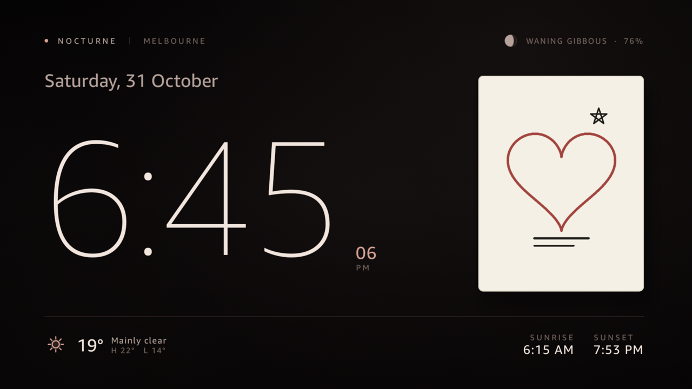
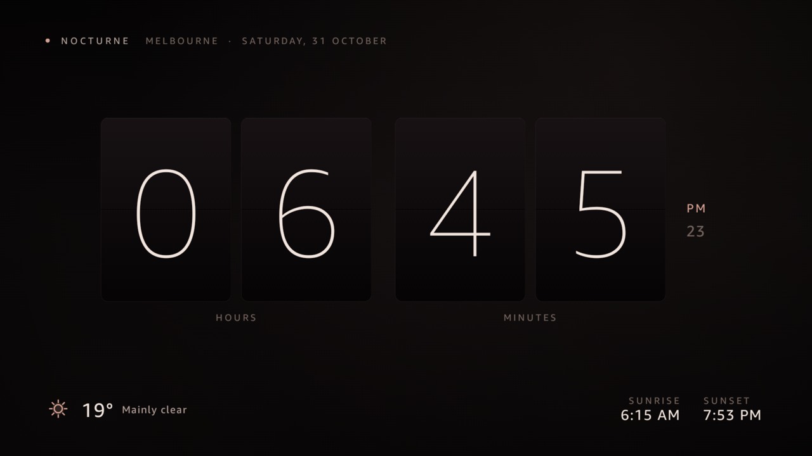
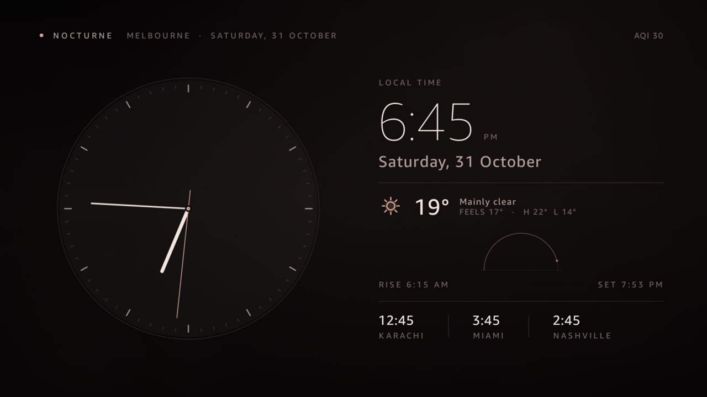
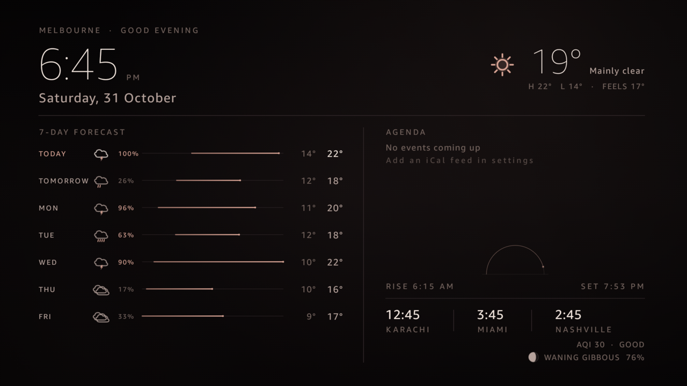
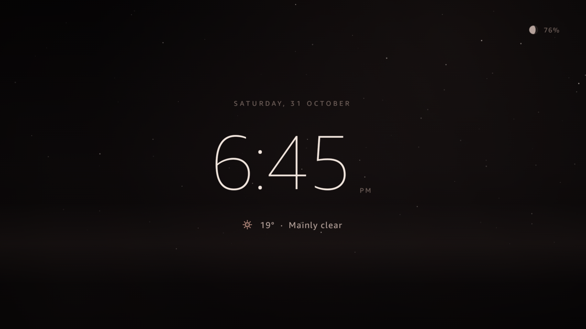
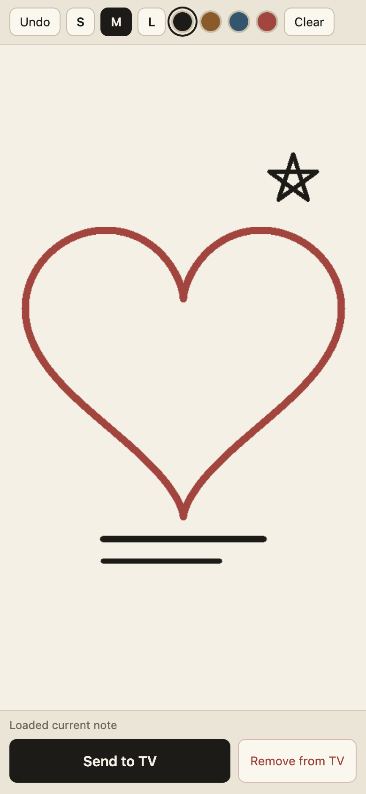
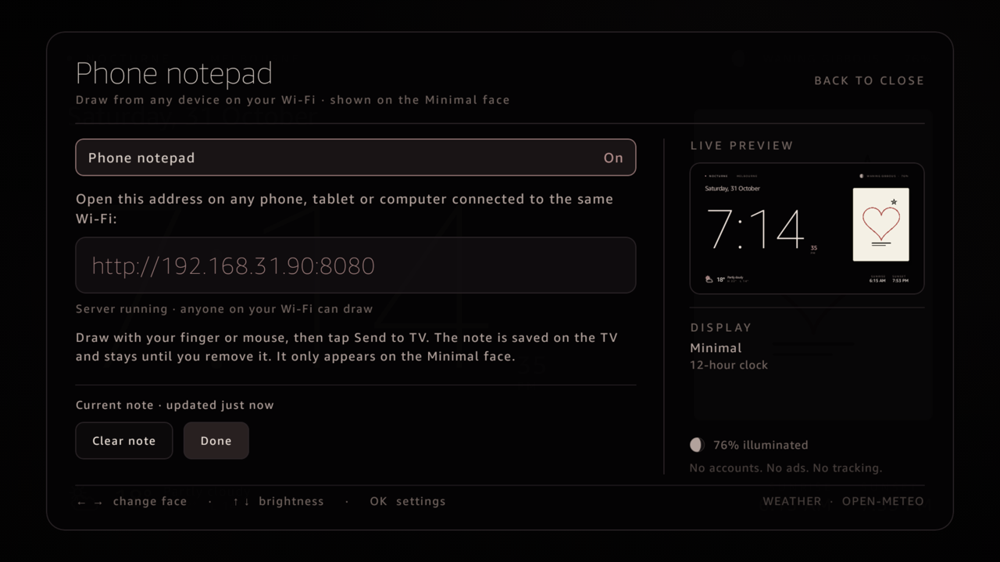
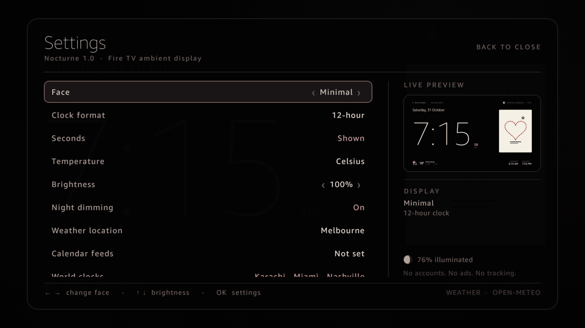

# Nocturne — Ambient clock for Fire TV Stick 4K

Nocturne turns a Fire TV Stick into a calm, always-on ambient display: a glanceable clock
with weather, sky, calendar, and world-clock data — plus an optional note you can draw on
your phone and send to the TV. It is a native Kotlin + Jetpack Compose app built for the
10-foot screen, not a launcher or a web wrapper.

Built and tested on a Fire TV Stick 4K (Fire OS 7/8). It ships as a debug APK you sideload
over ADB. There is no account, subscription, ad, or telemetry.

## Features

### Five clock faces
- **Minimal** — large clock and date with current weather, sunrise/sunset, and the optional
  phone note card.
- **Flip** — split-flap style hour and minute cards with a seconds readout.
- **Analog** — classic dial with tick marks and a thin seconds hand.
- **Dashboard** — time, date, 7-day forecast, calendar agenda, sun arc, world clocks, AQI,
  and moon phase in one dense layout.
- **Ambient** — dim starfield clock for dark rooms and overnight display.

### Weather, sky, and time
- Open-Meteo current conditions, 7-day forecast, and air quality (AQI).
- Automatic IP-based location, with manual latitude/longitude override.
- Sunrise/sunset arc, day length, moon phase, and illumination percentage.
- 12-hour or 24-hour clock, optional seconds, Celsius or Fahrenheit.
- Configurable world clocks for any IANA time zone.

### Calendar
- Add private iCal/ICS feed URLs; upcoming events show on the Dashboard face.

### Phone notepad
- Draw on any phone, tablet, or computer on the same Wi-Fi at `http://<fire-tv-ip>:8080`.
- Notes appear on the Minimal face, survive restarts, and can be wiped from either device.
- LAN-only embedded server; no cloud, account, or internet access required.

### Display and TV integration
- Adjustable brightness plus automatic night dimming.
- Burn-in protection with slow pixel shift.
- Remote-friendly controls: D-pad face switching, brightness, settings, weather HUD, and
  jump keys 1–5.
- Launch on boot, DreamService support, and a KEEP_SCREEN_ON interactive mode.

### Private by default
- No accounts, ads, subscriptions, or telemetry.
- Weather, location, and calendar calls are the only outbound requests.
- The notepad server is reachable only from your LAN and can be switched off in Settings.

## Screenshots

Actual captures from a Fire TV Stick 4K and a 390 × 844 phone viewport.

<p align="center">
  
</p>

| Flip | Analog | Dashboard | Ambient |
| :---: | :---: | :---: | :---: |
|  |  |  |  |

### Phone notepad

<p align="center">
  
  
</p>

### Settings

<p align="center">
  
</p>

## Files
- `app/` — Kotlin + Jetpack Compose app source
- `docs/screenshots/` — captures used in the gallery above
- `build.gradle.kts`, `settings.gradle.kts`, `gradle/` — Gradle build with wrapper included
- APK build output — `app/build/outputs/apk/debug/app-debug.apk` (not committed)

## Build
Requires JDK 21, Android SDK platform 34, and build-tools 34.0.0. The Gradle wrapper
handles Gradle itself.

```bash
export JAVA_HOME=/opt/homebrew/opt/openjdk@21   # example path on macOS
./gradlew assembleDebug
```

If the SDK is not auto-detected, point the build at it with `ANDROID_HOME` or a `sdk.dir`
line in `local.properties`.

Output: `app/build/outputs/apk/debug/app-debug.apk`

## Install & run on Fire TV
Enable ADB debugging on the Fire TV, then:

```bash
adb connect <fire-tv-ip>:5555
adb install -r app/build/outputs/apk/debug/app-debug.apk
adb shell am start -n dev.nocturne.ambient/.MainActivity
```

## Remote controls
- D-pad left/right — previous/next face
- D-pad up/down — brightness
- OK — open settings
- Menu — toggle settings
- 1–5 — jump straight to a face
- Info — weather HUD
- Media Play/Pause — Ambient face

## Phone notepad
Enabled by default and shown on the Minimal face only. Toggle it in
**Settings → Phone notepad**. While enabled, the TV runs a small local web server:

1. Open `http://<fire-tv-ip>:8080` on any phone, tablet, or computer on the same Wi-Fi.
2. Draw with a finger or mouse, pick a pen size/color, then tap **Send to TV**.
3. The note appears in the right-hand area of the Minimal face and survives restarts.

Wipe it from the phone with **Remove from TV**, or on the TV with
**Settings → Phone notepad → Clear note**. Sending an empty canvas also removes it. The server
is open to anyone on the same LAN — turn the notepad off to stop it. No cloud, account, or
internet access is involved.

## Notes
- Fonts use system Amazon Ember (Thin/Regular) on Fire OS; falls back to sans-serif.
- Auto-location resolves via IP (ipapi.co/ipinfo.io) and may differ from GPS. Override in
  Settings → Weather location.
- Fire OS doesn't surface DreamService; the interactive activity with KEEP_SCREEN_ON is the
  working TV display path.

No ads, accounts, subscriptions, or telemetry.
